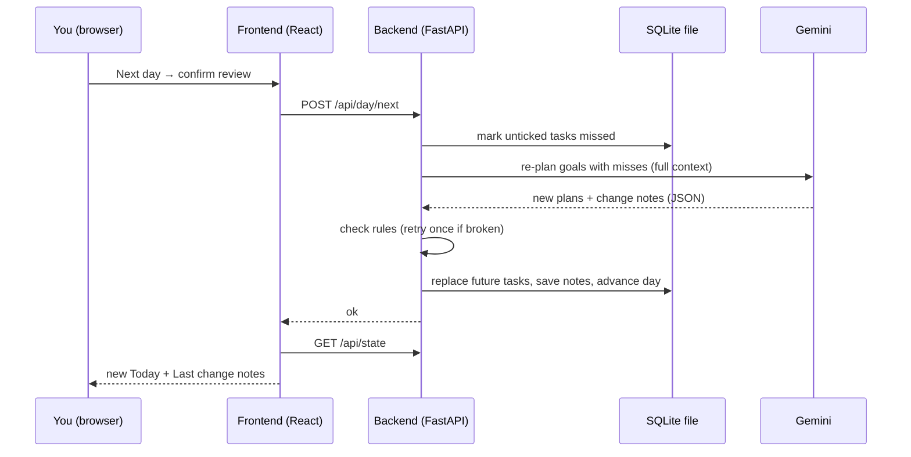
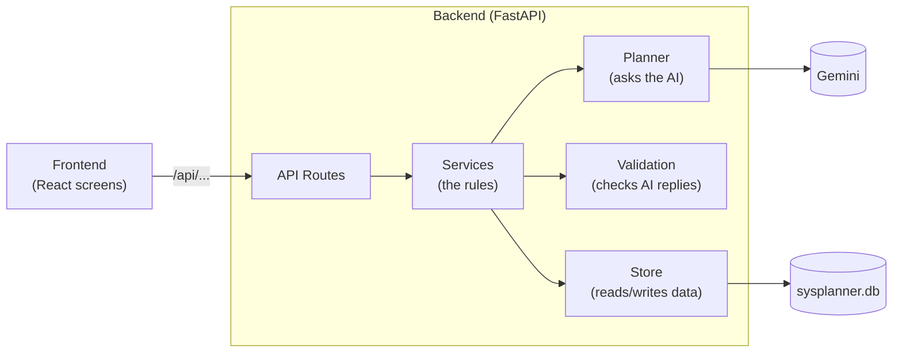

# SysPlanner (working name) — Technical Spec

## How This Works, In Plain Language

SysPlanner is two programs on your laptop that talk to each other, plus one file and one outside service.

- **The backend** is a Python program built with **FastAPI**. It holds all the rules: the 3-goal cap, what counts as missed, when to re-plan. It is the only part that talks to the AI and the only part that reads and writes the data file.
- **The frontend** is the screen you click on, written in **TypeScript with React**, and turned into something the browser can run by **Vite**. It shows the sidebar, Today, the Goal view and the dialogs. It never decides anything; it asks the backend and shows what comes back.
- **The data file** is a **SQLite** database: one file on your laptop (`data/sysplanner.db`). Your daily hours, goals, breakdowns, every task and every tick live there, so closing the app loses nothing.
- **The AI** is **Gemini**, reached through a small "planner" layer in the backend. Whenever a plan needs to be built or changed, the backend sends Gemini the full picture (your daily hours, today's date, every goal and its tasks, what you missed) and asks for the answer in a fixed shape. That shape is defined once in Python, so the backend can check the reply before trusting it. The planner layer has a slot for OpenAI too, but only Gemini is built.

The one idea to hold on to: **the AI proposes, the backend checks, the database remembers.** Every AI reply passes code rules (every task has a done criterion, an estimate and a why; no day goes over your daily hours; nothing runs past the deadline) before it is saved. If a reply breaks a rule, the backend asks once more, then shows a calm "planning failed, retry" message and changes nothing.

Days are simulated. The app keeps its own "current day" in the database, starting on the real date of your first open, and **Next day** moves it forward by one.

Why this shape and not something bigger: it's single-user and clone-and-run, so there are no accounts, no cloud database and no hosting. The only thing outside your laptop is the AI, because the AI is the product.

## The Core Journey Through the System

PRD ref: `prd.md > The Core Journey`.

1. **First open.** The frontend asks the backend for the whole app state (`GET /api/state`). There are no settings yet, so it shows the daily-hours step. You type 8; the frontend sends it (`POST /api/settings`); the backend saves it and sets the current day to today's real date.
2. **Add a goal.** You enter "Get a scholarship to study abroad" and its deadline. The frontend sends it (`POST /api/goals/clarify`). The backend checks the cap, then makes one small AI call that returns the questions Gemini needs answered to plan this goal (possibly none). The dialog shows them with answer boxes.
3. **SMART goal, feasibility + system.** You answer once and the frontend sends goal, deadline and answers (`POST /api/goals`), showing "Planning…". The backend checks the cap again, then makes one AI call with your daily hours, the current day, the existing goals, and the new goal with its answers. Gemini replies with a SMART version of the goal, the assumptions it made, and a verdict:
   - **Impossible:** the backend saves nothing and returns the message and assumptions. The dialog shows them and lets you change the deadline or your answers. You submit again, which is a fresh call.
   - **Stretch / comfortable:** the reply also contains the new goal's breakdown and day-by-day plan, plus any rework of existing goals. The backend checks the rules, then in one transaction saves the new goal and applies the rework (replacing existing goals' unticked tasks from today onward and writing their **Last change** notes). The goal appears in the sidebar and its Goal view opens.
4. **More goals.** Steps 2–3 repeat for goals 2 and 3. A 4th gets a plain refusal from the backend (HTTP 409) before any AI call. The saved answers and SMART goal travel with the goal into every later plan and re-plan, so the AI never falls back to guessing.
5. **Today.** `GET /api/state` returns today's tasks across all goals, labelled by goal. Ticking one sends `POST /api/tasks/{id}/toggle`; the backend saves it and the frontend refreshes state.
6. **Next day → review.** The frontend opens the review dialog: today's unticked tasks (ticks there use the same toggle call) plus an optional update box per goal. With nothing unticked, it shows only the update boxes.
7. **Re-plan.** Confirming sends `POST /api/day/next` with any updates. The backend saves the updates, marks today's unticked tasks as **missed**, then makes one AI call covering only the goals with misses or new updates, starting from tomorrow. With neither, it just advances the day. It checks the rules, then in one transaction replaces those goals' tasks from tomorrow onward, writes their **Last change** notes and advances the current day. If the AI fails, nothing changes; the day doesn't advance and you can retry.
8. **See what changed / repeat.** The frontend refreshes state: Today shows the new day, and each re-planned goal's Goal view shows its note.
9. **Update any time.** On a Goal view, "Anything new?" sends `POST /api/goals/{id}/updates`. The backend saves it and re-plans that goal from the current day onward (ticked tasks stay), in one transaction, with the same rule checks.



## Stack

| Piece | Choice | Docs |
|---|---|---|
| Backend language | Python 3.12+ | https://docs.python.org/3/ |
| Web framework | FastAPI (served by Uvicorn) | https://fastapi.tiangolo.com/ |
| Data shapes and checks | Pydantic v2 (comes with FastAPI) | https://docs.pydantic.dev/latest/ |
| Storage | SQLite via Python's built-in `sqlite3` module, no ORM | https://docs.python.org/3/library/sqlite3.html |
| AI | Gemini via the `google-genai` SDK | https://googleapis.github.io/python-genai/ · https://ai.google.dev/gemini-api/docs/structured-output |
| Config | `python-dotenv` reads `.env` | https://pypi.org/project/python-dotenv/ |
| Tests | pytest + FastAPI `TestClient` | https://docs.pytest.org/ · https://fastapi.tiangolo.com/tutorial/testing/ |
| Python tooling | `uv` (a `pyproject.toml`; plain `pip` also works) | https://docs.astral.sh/uv/ |
| Frontend | React 19 + TypeScript, built with Vite | https://react.dev/ · https://vite.dev/guide/ |
| Styling | Plain CSS with CSS variables (no CSS framework) | — |
| Fonts | Google Fonts: Cormorant Garamond (headings), Inter (body) | https://fonts.google.com/ |

Rationale:
- **Python + FastAPI** (learner's choice): Python is your strongest language, so the part with the rules and the AI is the part you can read best.
- **React + TypeScript + Vite** (learner's choice, from my recommendation): the screen has many parts that depend on the same data (sidebar, three views, two dialogs, ticks, loading states), and React keeps them in sync. The tradeoff you accepted is two programs during development; for the demo FastAPI serves the built frontend, so it's one command and one URL.
- **SQLite** (learner's choice, from my recommendation over Firebase): one local file with zero setup, built into Python, fits single-user clone-and-run. Firebase would add a cloud project, config and access rules for no POC benefit.
- **Gemini first, OpenAI slot** (learner's choice): a `Planner` interface with one Gemini implementation; `AI_PROVIDER` in `.env` picks it. The OpenAI file is a stub that raises "not implemented."
- **Plain `sqlite3` and plain CSS** (implementation details I chose): each avoids one more library to learn. Pydantic already defines the shapes, and the app only has three tables.

Checked against current docs during this session (Context7, `googleapis/python-genai`): structured output works by passing `response_mime_type="application/json"` and `response_json_schema=MyModel.model_json_schema()` to `client.models.generate_content`. The alias `gemini-flash-latest` always points to the newest Flash model, and `gemini-2.5-pro` / `gemini-pro-latest` exist. **Still to verify early in the build:** the real cost of one call on your paid key (see **Gemini API > Cost**), and whether Flash's plans are good enough or Pro is needed (see **Decisions and Open Issues**).

## Where It Runs and How Someone Tries It

**Runs locally** in a desktop browser. Requirements: Python 3.12+, Node.js 20+, a Gemini API key.

Setup (once):
```bash
cp .env.example .env            # then put your key in GEMINI_API_KEY
uv sync                         # Python dependencies
cd frontend && npm install && cd ..
```

**Development** (two terminals):
```bash
uv run uvicorn backend.app.main:app --reload --port 8000
cd frontend && npm run dev      # open http://localhost:5173 (Vite forwards /api to :8000)
```

**Demo / someone trying it** (one program):
```bash
cd frontend && npm run build && cd ..
uv run uvicorn backend.app.main:app --port 8000   # open http://localhost:8000
```

**Fresh start for a recording:** stop the server and delete `data/sysplanner.db`. The next start recreates it empty.

**Submission:** a short demo video plus a public GitHub repository are required. No deployment is planned (`prd.md > Deferred From the POC`: public hosted version). The demo follows `prd.md > The Core Journey > Success (the demo)`: daily hours → add the scholarship goal → add two more → refused on a 4th → tick some → leave one unticked → Next day → review → **Last change** note. AI calls take a while, so trim the waits in the edit.

## Look and Feel

Carried from `prd.md > Look and Feel`. Colors and vibe only from the Yggdrasil reference: no name, logo or layouts.

CSS variables in `frontend/src/styles/theme.css`:

| Variable | Use | Starting value |
|---|---|---|
| `--bg` | page background, very dark forest green | `#0f1f17` |
| `--surface` | cards, sidebar, dialogs | `#172b20` |
| `--surface-raised` | hover, active rows | `#1e3628` |
| `--border` | thin card borders | `#2b4636` |
| `--sage` | secondary labels, calm accents, ticked tasks | `#9bb5a0` |
| `--gold` | active sidebar marker, key dates, emphasis, primary buttons | `#c9a550` |
| `--text` | primary text, off-white | `#efeadd` |

- **Typography:** Cormorant Garamond (serif) for page titles and headings; Inter for body; small labels in uppercase Inter with `letter-spacing: 0.12em`, in sage.
- **Shape and space:** rounded cards (`border-radius: 14px`), 1px `--border` borders, generous padding (24px cards, 32px page gutters), left sidebar about 260px wide with a 3px gold bar on the active item.
- **States without guilt:** no red anywhere. Missed tasks in past days are dimmed sage, not flagged. Errors use the normal surface with a gold-outlined "Try again". "Planning…" is a quiet pulsing gold dot with a line of text.
- **Copy tone:** calm and plain. "Planning your system…", "Nothing left for today", "Re-planned: …".

## Components

### The Big Picture

The whole app is six pieces. Each has one job.



| Piece | Its one job | Lives in |
|---|---|---|
| Frontend | Shows the state and sends your clicks. Decides nothing. | `frontend/src/` |
| API Routes | Receives requests and passes them to Services. | `backend/app/main.py` |
| Services | Applies the rules for each action: set hours, add goal, tick, next day. | `backend/app/services.py` |
| Planner | Asks the AI for a plan. | `backend/app/planner/` |
| Validation | Rejects AI plans that break the rules. | `backend/app/validation.py` |
| Store | Reads and writes the data file. | `backend/app/db.py` |

Every action follows the same path: **Frontend → Routes → Services → (Planner → Validation) → Store → Frontend re-reads the state.** Only adding a goal and Next day go through the Planner.

The sections below say a little more about each piece. The exact routes, prompt rules and validation rules are in **Build Reference**, further down. You don't need them to follow the design.

### Backend

#### API Routes (`backend/app/main.py`)
Five endpoints, one per action, plus `GET /api/state` to read everything. Does no thinking itself. It also serves the built frontend for the one-command demo. PRD ref: all views.

#### Services (`backend/app/services.py`)
One function per action. Each one loads what it needs, calls the Planner if needed, runs Validation and saves everything in one go (or saves nothing). The three guard rules:
- Adding a goal is refused without an AI call when there are already 3 goals.
- Next day skips the AI when nothing was missed.
- Ticking only works on the current day.

PRD ref: `prd.md > Goal Cap`, `prd.md > Next Day, Review and Re-plan`, `prd.md > States and Boundaries`.

#### Planner Layer (`backend/app/planner/`)
Builds the prompt, calls the AI and returns a plan in a fixed shape. There are three interchangeable versions: **Gemini** (the real one), **OpenAI** (an empty slot) and **Fake** (canned plans so tests don't need the AI). `.env` picks which one runs. PRD ref: `prd.md > The System (Breakdown + Day-by-Day Plan)`, `prd.md > Adding a Goal`, `prd.md > Last Change Note`.

#### Validation (`backend/app/validation.py`)
Checks every AI plan against the rules: complete tasks, dates inside the deadline, no day over the daily hours. If a plan fails, the AI gets one retry with the problems listed. If it fails again, you see the calm "planning failed" message and nothing changes. PRD ref: `prd.md > Daily Time Budget`, `prd.md > The System (Breakdown + Day-by-Day Plan)`.

#### Store (`backend/app/db.py`)
Opens the SQLite file (and creates it on first run) and saves all-or-nothing. Tests use a throwaway copy. PRD ref: `prd.md > Open Questions` (data across sessions).

### Frontend

`App.tsx` holds the app state and picks which view to show. Every other piece just displays part of that state or sends one action.

#### App Shell (`frontend/src/App.tsx`, `api.ts`, `types.ts`)
Loads the state, picks the view (daily-hours step, empty state, Today or a Goal view) and holds the "planning…" and error state. `api.ts` has one function per route.

#### Daily Hours Step (`DailyHoursStep.tsx`)
One number field and Continue, shown on first open. PRD ref: `prd.md > Daily Time Budget`.

#### Sidebar (`Sidebar.tsx`)
Today, your goals, and **Add goal** (disabled with a reason at 3 goals). PRD ref: `prd.md > Screens and Layout`, `prd.md > Goal Cap`.

#### Add Goal Dialog (`AddGoalDialog.tsx`)
Goal text and deadline, then the AI's clarifying questions with an answer box each (skipped if there are none). If the goal is impossible, it shows the AI's message and assumptions and lets you change the date or answers. Once the goal is added, it opens the new goal's view. PRD ref: `prd.md > Adding a Goal`.

#### Today View (`TodayView.tsx`, `TaskCard.tsx`)
Today's tasks across all goals, each with its done criterion, minutes, why and a tick box, plus the **Next day** button. PRD ref: `prd.md > Today and Marking Done`, `prd.md > States and Boundaries`.

#### Goal View (`GoalView.tsx`, `Breakdown.tsx`, `DayPlan.tsx`, `LastChangeNote.tsx`)
The goal, its SMART version and deadline, the breakdown into workstreams, the day-by-day plan (past days dimmed, today in gold), the **Last change** note, and the goal's updates with an "Anything new?" box (`UpdateBox.tsx`). PRD ref: `prd.md > The System (Breakdown + Day-by-Day Plan)`, `prd.md > Last Change Note`, `prd.md > Updates (What Happened)`.

#### End-of-Day Review (`ReviewDialog.tsx`)
Lists today's unticked tasks so you can tick any you actually did, plus an optional update box per goal, then **Confirm** to re-plan. PRD ref: `prd.md > Next Day, Review and Re-plan`, `prd.md > Updates (What Happened)`.

#### Planning Indicator and Error Notice (`PlanningIndicator.tsx`, `ErrorNotice.tsx`)
A quiet pulsing dot while the AI works. If it fails, a calm "Nothing was changed" card with **Try again**. PRD ref: `prd.md > States and Boundaries`.

## Data Model

SQLite, three tables. Dates are ISO strings (`YYYY-MM-DD`).

```sql
settings (id INTEGER PRIMARY KEY CHECK (id = 1),
          daily_hours INTEGER NOT NULL,         -- hours to plan for per day, weekends included
          current_day TEXT NOT NULL)            -- simulated "today"

goals    (id INTEGER PRIMARY KEY,
          text TEXT NOT NULL,
          deadline TEXT NOT NULL,
          feasibility TEXT,                     -- 'stretch' | 'comfortable'
          smart_goal TEXT NOT NULL,             -- AI-written SMART version of the goal
          clarifications_json TEXT NOT NULL,    -- [{question, answer}] from the add-goal dialog
          breakdown_json TEXT NOT NULL,         -- [{name, minutes_per_week, purpose}]
          last_change TEXT,                     -- latest change note, null = no changes yet
          created_on TEXT NOT NULL)

tasks    (id INTEGER PRIMARY KEY,
          goal_id INTEGER NOT NULL REFERENCES goals(id),
          day TEXT NOT NULL,
          title TEXT NOT NULL,
          done_criterion TEXT NOT NULL,
          minutes INTEGER NOT NULL,
          why TEXT NOT NULL,
          status TEXT NOT NULL DEFAULT 'planned' CHECK (status IN ('planned','done','missed')))

updates  (id INTEGER PRIMARY KEY,
          goal_id INTEGER NOT NULL REFERENCES goals(id),
          day TEXT NOT NULL,                    -- simulated day it was written
          text TEXT NOT NULL)                   -- what happened or changed, in the user's words
```

AI reply shapes (Pydantic, in `backend/app/models.py`):
- `TaskPlan {day, title, done_criterion, minutes, why}`
- `Workstream {name, minutes_per_week, purpose}`
- `GoalPlan {goal_id, smart_goal, breakdown: [Workstream], tasks: [TaskPlan], change_note}`. On re-plans, `smart_goal` is the (possibly rewritten) SMART goal
- `Clarify {questions: [str]}`: what the AI must know to plan this goal; empty if it's already specific.
- `NewGoalPlan {smart_goal, assumptions: [str], verdict: "impossible"|"stretch"|"comfortable", message, new_goal: GoalPlan | null, rework: [GoalPlan]}`. `rework` lists only existing goals that change.
- `Replan {goals: [GoalPlan]}`, covering only goals with misses or new updates.

| Data | Where it lives | How it's updated | When you leave and come back |
|---|---|---|---|
| Daily hours, current day | `settings` row | set once; `current_day` +1 on Next day | same day, same hours |
| Goal + breakdown | `goals` row | written on add (with SMART goal and answers); breakdown replaced on rework or re-plan | unchanged |
| Tasks | `tasks` rows | Adding a goal inserts its tasks and applies the rework: existing goals' still-`planned` tasks from the current day onward are replaced (ticked ones stay). Re-plan replaces tasks from tomorrow onward. Past and ticked tasks are never rewritten | ticks and history intact |
| Ticks | `tasks.status` | toggle sets `done`/`planned` (current day only); Next day sets leftover `planned` → `missed` | intact |
| Last change note | `goals.last_change` | overwritten by add-goal rework or re-plan | intact |
| Updates | `updates` rows | appended from the Goal view or end-of-day review; never edited | intact, sent with every later plan |
| Which view is open, dialog state | React state only | clicks | resets to Today (fine for the POC) |

## File Structure

How to read it: `backend/app/` is the rules, `backend/app/planner/` is the AI, `backend/tests/` proves the rules, and `frontend/src/components/` is one file per screen piece. Everything else is setup.

```
sysplanner/
├── backend/
│   ├── app/
│   │   ├── main.py            # FastAPI app, /api routes, serves frontend/dist
│   │   ├── services.py        # the rules: daily hours, add goal, toggle, next day
│   │   ├── validation.py      # code checks on every AI reply
│   │   ├── models.py          # Pydantic shapes: API bodies, AppState, AI reply schemas
│   │   ├── db.py              # SQLite connection, schema, queries, transactions
│   │   ├── config.py          # reads .env (AI_PROVIDER, GEMINI_API_KEY, GEMINI_MODEL, DB path)
│   │   └── planner/
│   │       ├── base.py        # Planner interface + get_planner()
│   │       ├── prompts.py     # instructions sent to the AI
│   │       ├── gemini.py      # the real planner (google-genai)
│   │       ├── openai.py      # empty slot for later experiments
│   │       └── fake.py        # canned plans for tests
│   └── tests/
│       ├── conftest.py        # temp DB + fake planner fixtures
│       ├── test_budget_and_goals.py   # daily hours, add goal, feasibility loop, cap
│       ├── test_today_next_day.py     # ticking, review skip, missed marking, re-plan, day advance
│       ├── test_validation.py         # each rule, retry-once, failure changes nothing
│       └── test_gemini_live.py        # opt-in real call (skipped unless RUN_LIVE=1)
├── frontend/
│   ├── index.html             # loads fonts
│   ├── vite.config.ts         # dev proxy /api → localhost:8000
│   ├── package.json
│   ├── tsconfig.json
│   └── src/
│       ├── main.tsx
│       ├── App.tsx            # loads state, picks view, holds planning/error state
│       ├── api.ts             # one typed function per backend route
│       ├── types.ts           # mirrors backend shapes
│       ├── styles/
│       │   ├── theme.css      # colors, fonts, spacing variables
│       │   └── app.css        # layout and component styles
│       └── components/
│           ├── Sidebar.tsx
│           ├── DailyHoursStep.tsx
│           ├── AddGoalDialog.tsx
│           ├── TodayView.tsx
│           ├── TaskCard.tsx
│           ├── GoalView.tsx
│           ├── Breakdown.tsx
│           ├── DayPlan.tsx
│           ├── LastChangeNote.tsx
│           ├── ReviewDialog.tsx
│           ├── PlanningIndicator.tsx
│           └── ErrorNotice.tsx
├── data/                      # sysplanner.db lives here (gitignored)
├── devpost/                   # Devpost learning workspace
├── .env.example               # AI_PROVIDER=gemini, GEMINI_API_KEY=, GEMINI_MODEL=gemini-flash-latest
├── pyproject.toml
└── README.md                  # setup, run, demo steps
```

## Build Reference

Exact details for `5-build`. The design is fully described above; this section is lookup material.

### API Routes in Detail
Errors map to status codes: 409 for cap and precondition refusals, 502 for AI failure.

| Method + path | Body | Returns | PRD ref |
|---|---|---|---|
| `GET /api/state` | — | full `AppState` (below) | all views |
| `POST /api/settings` | `{daily_hours: int}` | `AppState` | `prd.md > Daily Time Budget` |
| `POST /api/goals/clarify` | `{text, deadline}` | `{questions: [str]}` | `prd.md > Adding a Goal`, `prd.md > Goal Cap` |
| `POST /api/goals` | `{text, deadline, clarifications: [{question, answer}]}` | `{status:"impossible", message, smart_goal, assumptions}` or `{status:"added", goal_id, state}` | `prd.md > Adding a Goal`, `prd.md > Goal Cap`, `prd.md > The System (Breakdown + Day-by-Day Plan)` |
| `POST /api/tasks/{id}/toggle` | `{done: bool}` | `AppState` | `prd.md > Today and Marking Done` |
| `POST /api/day/next` | `{updates: [{goal_id, text}]}` | `AppState` | `prd.md > Next Day, Review and Re-plan`, `prd.md > Updates (What Happened)` |
| `POST /api/goals/{id}/updates` | `{text}` | `AppState` (after re-plan) | `prd.md > Updates (What Happened)` |

`AppState` = `{settings: {daily_hours, current_day} | null, goals: [Goal with breakdown, tasks, last_change], today: [Task with goal_id/goal_text]}`. The frontend re-reads the whole state after every action. With at most 3 goals the state is small, and the screen can never drift from the database. `types.ts` mirrors these shapes by hand.

### Planner in Detail
- `base.py`: the `Planner` protocol, with `clarify(ctx) -> Clarify` (questions before planning), `plan_new_goal(ctx) -> NewGoalPlan` (adding a goal) and `replan(ctx) -> Replan` (after misses). `get_planner()` reads `AI_PROVIDER` from `.env`.
- `gemini.py`: `client.models.generate_content(model=GEMINI_MODEL, contents=prompt, config=GenerateContentConfig(response_mime_type="application/json", response_json_schema=Schema.model_json_schema()))`, then `Schema.model_validate_json(response.text)`.
- `openai.py`: raises `NotImplementedError("OpenAI planner not built yet")`.
- `fake.py`: fixed plans for tests; can be told to return impossible, rule-breaking or failing replies.
- `prompts.py` tells the AI to:
  - before planning, ask only the questions it can't plan without (size and nature of the outcome, how the user will work, what "done" means), and none if the goal is already specific;
  - restate the goal as a SMART goal from the text, answers and deadline, list its remaining assumptions, and plan against that;
  - build workstreams with time budgets, then derive daily tasks from them;
  - size the plan to the goal, not the deadline;
  - surface long-lead steps (things that depend on other people);
  - give every task a done criterion, minutes and a why;
  - plan jointly with the other goals and merge shared work where sensible;
  - stay within the daily hours on every day, prioritizing and cutting rather than squeezing;
  - prefer focused, grouped sessions on one goal over small tasks spread across goals (days needn't be even);
  - keep one day a week free of all tasks, placed where it hurts least;
  - be honest about feasibility (impossible vs. stretch vs. comfortable);
  - write change notes in calm, plain words naming days and tasks and saying whether the deadline is still met;
  - when the verdict hinges on an unconfirmed assumption, name it in the message and say what the verdict would be if it's wrong;
  - treat the user's updates as facts that override earlier assumptions, and rewrite the SMART goal when an update changes the goal itself.

### Validation Rules in Detail
`check_plan(ctx, reply) -> list[str]` returns plain-language problems, or an empty list if the plan is fine.
- Every task has a non-empty title, done criterion and why, and `minutes > 0`.
- Dates fall between the plan's start day and the goal's deadline, inclusive.
- Every referenced goal exists, and every changed goal has a change note.
- **Daily budget:** on every day, total minutes across all goals (including the one being added) ≤ `daily_hours × 60`.
- **Free day:** every Monday–Sunday week has at least one day with no tasks from any goal. The AI chooses which; an update can move it.

If there are problems, the service calls the planner once more with the problems appended to the prompt. If the second reply also fails, it raises `PlanningFailed` (HTTP 502).

## External Services and Dependencies

### Gemini API
- **Call:** `google.genai.Client()` reads `GEMINI_API_KEY` from the environment, then `client.models.generate_content(...)` with JSON structured output as described in **Planner Layer**. Two calls per goal added: a small clarify call, then the plan call (plus one if a validation retry happens), zero per tick, one per Next day with misses.
- **Model:** `GEMINI_MODEL`, default `gemini-flash-latest`; switch to `gemini-pro-latest` if plan quality is weak. Pro costs several times more per call.
- **Key:** your own Gemini key in `.env`, never committed (`.env` is already gitignored).
- **Docs:** https://googleapis.github.io/python-genai/, https://ai.google.dev/gemini-api/docs/structured-output, https://ai.google.dev/gemini-api/docs/models
- **Cost:** your key is pay-as-you-go (billed after use), currently covered by about $10 of Google credit. Every real AI call spends money; ticks and tests don't.
  - **Measured in slice 1 (paid key, `gemini-flash-latest` → gemini-3.8-flash):** a clarify call takes ~6 s and ~1k tokens; a scholarship plan call takes ~35 s and ~6k tokens (including thinking), with a ~12 KB reply. The same plan on `gemini-pro-latest` took ~80 s and ~13k tokens. Original estimate, for reference: ~$0.10 per big Flash call and ~$0.40 per Pro call at October 2026 prices; measured calls are several times smaller than that estimate.
  - Building and recording the demo takes a few dozen calls. That fits on Flash, but repeated Pro runs or retries could use up the credit.
  - **Guards:** the test suite uses the Fake planner, so it costs nothing. The live test only runs with `RUN_LIVE=1`. The Gemini planner logs each call's token counts (`response.usage_metadata`) to the terminal so you can see what each call spends. Set a budget alert in Google Cloud Billing (it emails you; it doesn't stop spending), and check when the $10 credit expires.
  - Prices: https://ai.google.dev/gemini-api/docs/pricing. Rate limits (not checked, unlikely to matter for one user): https://ai.google.dev/gemini-api/docs/rate-limits

### OpenAI API (slot only)
Not built. If you fill it in later, use structured outputs (https://platform.openai.com/docs/guides/structured-outputs) with the same Pydantic schemas. Check your employer's policy before using an employer-provided key on a personal project.

### Fonts
Google Fonts CDN link in `index.html`; falls back to Georgia / system sans-serif offline.

No other services: no hosting, no cloud database, no auth.

## Important Failure Modes

- **AI reply is too big or slow.** A long goal (e.g. a scholarship months away, or 16 products by year end) can run 80+ days with several tasks each, and adding a goal can also return rework for others. → The prompt keeps task text short and returns only changed goals. The UI shows "Planning…" for as long as it takes. The first build step measures one real call (see **Decisions and Open Issues**). If it's too large, fall back to detailed tasks for the next 14 days plus one summary line per later day.
- **AI reply breaks a rule** (over budget, missing why, past deadline). → One automatic retry with the problems listed. Then the calm "Planning didn't work this time. Nothing was changed." with Try again.
- **AI unavailable or bad key.** → Same calm error. Nothing saved, the day doesn't advance. A missing key is reported clearly at startup in the terminal.

## What Was Simplified and Why

- **Simulated day in the database** instead of real time: needed to demo the loop (`scope.md > Explicitly Cut`).
- **Whole-state refresh after every action** instead of fine-grained updates: three goals is tiny, and it removes a whole class of "screen shows old data" bugs.
- **One AI call per action with full context** instead of incremental edits: simpler prompts and the AI always sees the whole picture, which joint planning needs. The cost is bigger replies (see **Important Failure Modes**).
- **No feedback on a new system** (learner decision): the draft → feedback → commit flow was designed, then moved to `prd.md > Deferred From the POC` because the draft state complicated the cap, Next day and joint re-planning. The fuller version would add a goal `status` (draft/active), stored feedback and a previewed rework applied on commit.
- **OpenAI as a stub** instead of a second working provider: keeps the option open at no build cost.
- **Local only, no deploy:** the demo video and repo are what's required. Hosting is in `scope.md > Later`.

## Decisions and Open Issues

**Learner decisions (this session):**
- Python + FastAPI backend; React + TypeScript + Vite frontend (accepted my recommendation of React over plain TypeScript after the explanation of what Vite and React each do).
- Gemini first, with a slot for OpenAI.
- Your Gemini key is pay-as-you-go with about $10 of Google credit, not free tier. Cost is a real constraint, so Flash is the default and calls are logged.
- SQLite over Firebase (accepted recommendation).
- Verification is split in two (accepted recommendation): automated pytest tests with a fake AI for the rules, plus code checks on every AI reply, plus your own judgement on whether plans are believable.
- **Draft → feedback → commit moved to Later** after review, to keep the POC simple (`prd.md > Deferred From the POC`).

**Revised during the build (learner decision):**
- **Clarifying questions and an AI-written SMART goal before the verdict.** The first real call judged "Build 16 products by the end of 2026" impossible because it assumed full production software. The learner decided the tool, not the user, should close that gap: the AI asks what it's missing, the user answers once, and the AI writes the SMART goal it plans against (`prd.md > Adding a Goal`).

- **Demo goal switched to the scholarship.** After the 16-products run, the learner judged that goal too uncertain to evaluate the tool by (no ideas yet, heavy personalization). The scholarship goal is specific, common, and tests long-lead steps.
- **The AI never invents the user's choices.** The 3-products run invented two of the product ideas. The prompt now asks about choices the goal depends on and, if they're undecided, plans the work to make them.
- **Updates ("what happened") drive re-plans, not just misses.** The learner reframed the first plan as a well-informed draft that improves as real facts arrive. Updates come from the Goal view (re-plan now) and the end-of-day review (re-plan with that day's misses), are stored per goal, and are sent with every later plan (`prd.md > Updates (What Happened)`).
- **One free day a week, not a fixed day off.** The learner works some Sundays but wants one day a week for admin, chores and shopping, and it varies; the rule guarantees one empty day per Monday–Sunday week, the AI places it, and updates move it.
- **Daily hours instead of weekly.** The learner plans with a deliberately low daily number (8 h, weekends included) as a buffer that forces priorities; days may be uneven so one goal can get a deep day (`prd.md > Daily Time Budget`).
- **Paid key, not free tier.** On the free key, calls took 40 s–6 min queued at Google; on the paid key the same call takes ~2 s, and a clarify call ~7 s.

**Implementation details I derived:**
- The budget is checked per day, and ticking is only allowed on the current day.

**Your useful unknown:** at the start you asked how to check an agent's work when there's no original to compare against. It was clarified by the verification split:
- The PRD checkboxes are the reference, and each test is named after one.
- Code rules catch broken AI output automatically.
- Your judgement covers plan quality. With feedback deferred, a plan you don't believe means improving the prompt (`prompts.py`) or switching to a stronger model.

During the build, the evidence is the passing test suite, plus one real run on the scholarship goal that you judge against `prd.md > The System` (long-lead steps like reference letters surfaced early, no invented choices).

**Checked in slice 1:**
- **Reply size and latency:** done (see **Gemini API > Cost**). Replies are small enough that the 14-day fallback isn't needed.
- **Flash vs. Pro:** the learner compared both on the same saved answers and chose Flash: comparable quality at about half the tokens and less than half the time.
- Still worth doing: set a Google Cloud Billing budget alert, and check when the $10 credit expires.

**Carried from the PRD:**
- Final app name: revisit before `6-ship`.
